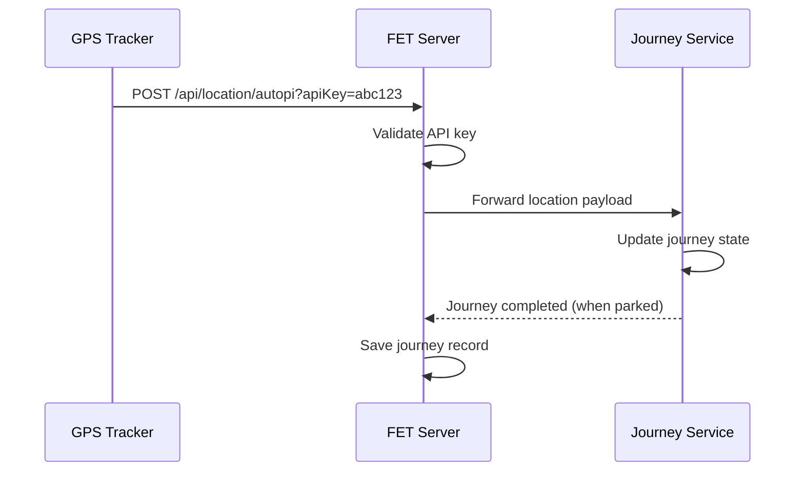

# Connecting a GPS Tracker

FET receives location data from GPS devices via a webhook. You generate an API key in the app, then paste the webhook URL into your device's settings.

## Supported tracker types

| Name      | Description                                              |
| --------- | -------------------------------------------------------- |
| `autopi`  | [AutoPi](https://www.autopi.io/) OBD-II cloud dongle     |
| `traccar` | [Traccar](https://www.traccar.org/) open-source platform |
| `generic` | Any device that can POST JSON                            |

## Generating an API key

1. Go to **Integrations** in the nav.
2. Find the row for your tracker type.
3. Click **Generate key**.
4. Copy the **Webhook URL** — you'll paste this into your device's settings.

:::caution
Clicking **Regenerate** creates a new key and immediately invalidates the old one. Update your device configuration straight away or pings will be rejected.
:::

## Configuring your device

### AutoPi

In the AutoPi dashboard, create a custom cloud endpoint:

- **Method**: `POST`
- **URL**: your webhook URL (includes the API key in the query string)
- **Payload**: leave as default — FET reads `lat`, `lon`, `velocity` (m/s), and `created_at` automatically.

### Traccar

In Traccar, add a notification webhook:

- **URL**: your webhook URL
- FET reads `lat`, `lon`, `speed` (mapped to velocity in m/s), and `deviceTime` (mapped to `created_at`).

### Generic (any device)

Configure your device to POST JSON to the webhook URL. The minimum required payload:

```json
{
    "lat": 51.5074,
    "lon": -0.1278,
    "created_at": "2024-06-01T08:00:00.000Z"
}
```

You can also include:

| Field      | Type   | Unit   | Effect                                                              |
| ---------- | ------ | ------ | ------------------------------------------------------------------- |
| `velocity` | number | m/s    | Speeds up journey detection (otherwise derived from position delta) |
| `distance` | number | metres | More accurate trip distance (otherwise calculated via Haversine)    |

## How pings flow through the system



## Troubleshooting

**No journeys appear after driving**

- Check that your device is sending pings to the correct webhook URL.
- Journeys only start when your speed exceeds ~25 km/h. If your tracker doesn't send velocity, make sure pings are frequent enough for FET to derive it.

**Journey never ends**

- FET waits for 60 seconds of low-speed readings before ending a trip. If your device stops sending pings when parked (e.g. on ignition off), consider sending a final "parked" ping so the journey closes cleanly.

**401 Unauthorized errors**

- Your API key may have been regenerated. Go to Integrations, copy the new webhook URL, and update your device.
