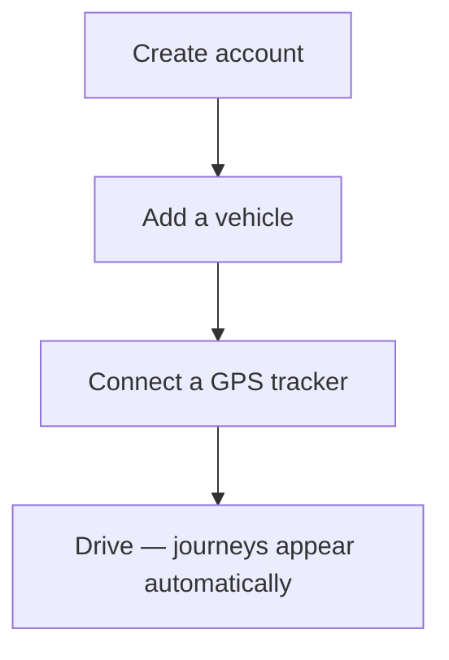

# Getting Started

## Create an account

Open the FET web app and click **Create one** on the login page.

Enter your email address and a password (minimum 8 characters), then click **Register**.

You'll be logged in automatically and taken to the dashboard.

## Explore the dashboard

After logging in you'll see four sections in the navigation:

| Section      | What it's for                            |
| ------------ | ---------------------------------------- |
| Journeys     | View all recorded trips                  |
| Vehicles     | Add vehicles and log odometer readings   |
| Integrations | Connect GPS trackers                     |
| Settings     | Update your display name and preferences |

## First-time setup checklist

1. **Add a vehicle** — go to Vehicles and click the **+** button. At minimum you need a registration number, make, model, and fuel type.
2. **Connect a tracker** — go to Integrations, pick your GPS device type, and click **Generate key**. Copy the webhook URL shown.
3. **Configure your device** — paste the webhook URL into your GPS tracker's cloud endpoint settings.
4. **Drive** — once your device is sending pings, journeys will appear in the dashboard automatically.

## Logging in on mobile

The web app is fully responsive. Open it in your phone's browser — navigation moves to a tab bar at the bottom of the screen.
