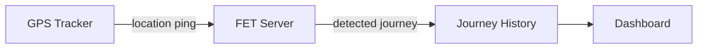

# FET — Fleet & Journey Tracker

FET is a self-hosted journey tracker. Connect a GPS device to your vehicle, and FET will automatically detect when you drive, record the trip, and keep a history of all your journeys.

## What you can do

- **Track journeys automatically** — no buttons to press. FET detects when you start and stop driving.
- **Log odometer readings** — keep a manual record of your mileage for any vehicle.
- **Connect multiple GPS trackers** — AutoPi, Traccar, or any device that can POST JSON.
- **View your trip history** — distance, duration, date, and whether you stopped at a petrol station.

## How it works

Your GPS device sends location pings to FET. FET analyses the pings to detect when a journey starts and ends, then saves the completed trip to your dashboard.

## Next steps

- [Getting Started](./getting-started) — create an account and log in
- [Connecting a Tracker](./connecting-a-tracker) — generate an API key and configure your device
- [Understanding Journeys](./tracking-journeys) — how FET detects trips
- [Managing Vehicles](./vehicles) — add vehicles and log odometer readings
