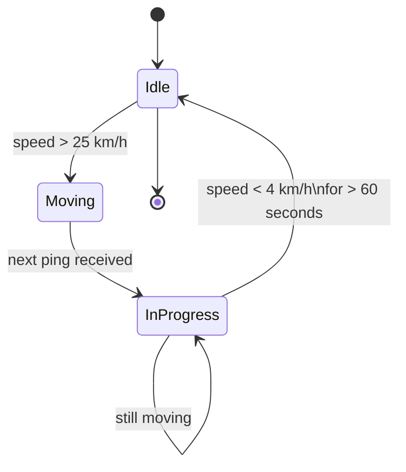

# Understanding Journey Tracking

FET tracks journeys automatically — no buttons to press. This page explains how it works so you know what to expect.

## How a journey is detected

FET analyses the speed reported in each location ping. When your speed rises above a threshold, a journey begins. When you've been stationary for long enough, the journey ends.

| Threshold           | Value      | Meaning                                                |
| ------------------- | ---------- | ------------------------------------------------------ |
| Journey start speed | > 25 km/h  | Below this, pings are ignored                          |
| Journey end speed   | < 4 km/h   | Vehicle is considered stationary                       |
| Stationary duration | 60 seconds | Must be stationary this long before the journey closes |

## One journey at a time

Only one journey can be active per account at a time. A new trip won't start until the previous one has ended.

## Distance calculation

If your GPS device doesn't send a `distance` value in each ping, FET calculates the distance between consecutive coordinates using the [Haversine formula](https://en.wikipedia.org/wiki/Haversine_formula). This is accurate to within ~0.5% for typical trip distances.

For the most accurate mileage figures, configure your device to include a `distance` field in each ping (see [Connecting a Tracker](./connecting-a-tracker)).

## What's shown on the dashboard

After a journey completes, it appears in the **Journeys** page with:

- **Date and start time**
- **Distance** (in km)
- **Duration**
- **Petrol stop** — flagged if the journey ended at or near a petrol station

## Petrol station detection

When a journey ends, FET checks whether the final location is near a petrol station. If so, the journey is tagged with a ⛽ petrol stop badge. The Journeys dashboard shows a count of petrol stops alongside your total trips and distance.
