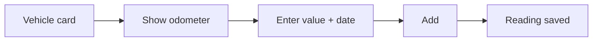

# Managing Vehicles

The Vehicles page lets you register your cars and log odometer readings over time.

## Adding a vehicle

1. Go to **Vehicles** in the nav.
2. Click the **+** button (top right).
3. Fill in the details:

| Field        | Required | Description                                   |
| ------------ | -------- | --------------------------------------------- |
| Registration | Yes      | Vehicle registration number (e.g. `AB12 CDE`) |
| Make         | Yes      | Manufacturer (e.g. `Toyota`)                  |
| Model        | Yes      | Model name (e.g. `Yaris`)                     |
| Fuel type    | Yes      | `Petrol`, `Diesel`, `Electric`, or `Hybrid`   |
| VIN          | No       | 17-character Vehicle Identification Number    |

4. Click **Save vehicle**.

## Odometer readings

Odometer readings let you track your mileage manually over time — useful for service intervals and expense records.

To log a reading:

1. Click on a vehicle card to expand it.
2. Click **Show odometer**.
3. Enter the current value (in km) and select the date.
4. Click **Add**.

The five most recent readings are shown below the form.

## Fuel type colours

Each vehicle card shows the fuel type as a colour-coded badge:

| Fuel type | Colour |
| --------- | ------ |
| Petrol    | Blue   |
| Diesel    | Grey   |
| Electric  | Green  |
| Hybrid    | Teal   |
